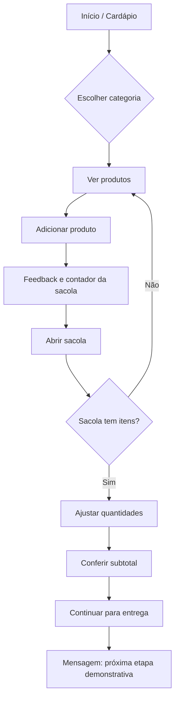

# Fluxo de navegação

## Regras de interação
- Selecionar filtro mostra somente a categoria correspondente; “Todos” restaura o cardápio.
- Cada toque em `+` incrementa a quantidade e atualiza contador/subtotal.
- No painel, `+` e `−` alteram quantidades; ao chegar a zero, o produto sai da sacola.
- Sacola vazia mostra orientação e impede avançar.
- Checkout com itens mostra feedback de que endereço/pagamento seriam a etapa seguinte.
- Fechar painel: botão `×`, tecla Escape ou clique no fundo.
